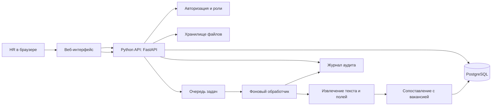

# Архитектура системы автоматизированного первичного отбора кандидатов

## 1. Назначение и границы системы

Система помогает HR быстро сопоставлять резюме с требованиями вакансии. Она извлекает сведения из резюме, анализирует соответствие заданным требованиям и готовит объяснимую первичную оценку.

**Система не принимает решение о найме или отказе.** Итоговый статус кандидату присваивает HR-специалист после изучения результата и исходных данных. Оценка модели — рекомендация, а не автоматический вердикт.

### Роли

- **HR-специалист:** создаёт вакансию, загружает резюме, изучает оценку и принимает решение.
- **Администратор:** управляет пользователями, ролями, настройками и сроками хранения.
- **Сервис анализа:** обрабатывает документы и формирует результат по заданным критериям.

## 2. Предлагаемая архитектура

Для первой версии рекомендуется модульный Python-бэкенд с отдельной фоновой очередью. Это позволит быстро выпустить MVP, сохранив возможность разделить компоненты на сервисы при росте нагрузки.



### Компоненты

1. **Веб-интерфейс** — создание вакансий и критериев, загрузка резюме, отслеживание статуса анализа, просмотр оценки и ручная фиксация решения. Для MVP подойдут React/TypeScript или серверные шаблоны.
2. **REST API на FastAPI** — валидация запросов, доступ к данным, запуск задач и выдача результатов. API не должен выполнять длительную обработку синхронно.
3. **PostgreSQL** — вакансии, критерии, метаданные резюме, результаты, пользовательские решения и история изменений.
4. **Хранилище файлов** — исходные резюме и, при необходимости, безопасно сформированные текстовые копии. В разработке допустимо локальное хранилище; для эксплуатации — объектное хранилище с шифрованием и ограниченными ссылками.
5. **Очередь и worker** — Celery/RQ с Redis или RabbitMQ. Worker извлекает текст, запускает анализ, сохраняет результат и обновляет статус задачи.
6. **Слой извлечения** — парсеры PDF/DOCX/TXT; при сканах — OCR как отдельный шаг. Исходный документ сохраняется неизменным, извлечённый текст доступен для проверки.
7. **Слой анализа** — нормализация опыта и навыков, сопоставление с критериями вакансии, расчёт баллов и формирование объяснений. Модель не должна использовать признаки, не относящиеся к работе.
8. **Аудит и наблюдаемость** — журналы действий, ошибки обработки, метрики времени и качества. Не записывать в технические логи полные тексты резюме и секреты.

## 3. Поток обработки

1. HR создаёт вакансию и задаёт критерии: обязательные и желательные навыки, требуемый опыт, образование или сертификаты, если они действительно необходимы для роли.
2. HR прикрепляет один или несколько файлов и выбирает вакансию.
3. API проверяет тип и размер файла, права доступа, создаёт запись кандидата и задачу со статусом `queued`.
4. Worker извлекает текст. Если содержимое нечитаемо, файл повреждён или OCR не удался, статус становится `needs_review` с понятной причиной.
5. Анализатор сопоставляет сведения резюме только с критериями вакансии. Для каждого критерия сохраняются найденный фрагмент/основание, оценка и уверенность извлечения.
6. Интерфейс показывает результат и ограничения. HR открывает оригинальное резюме, проверяет основания и вручную выбирает дальнейшее действие.
7. Решение HR и, при желании, причина фиксируются отдельно от оценки модели. Это позволяет отличать вывод алгоритма от кадрового решения.

## 4. Логика первичной оценки

Рекомендуется начинать с прозрачной оценки по критериям, а не с единого непрозрачного прогноза «подходит/не подходит».

Пример весов для конфигурируемой модели оценки:

| Критерий | Пример веса |
|---|---:|
| Обязательные профессиональные навыки | 40% |
| Релевантный опыт | 30% |
| Желательные навыки | 20% |
| Образование/сертификат, если требуется вакансией | 10% |

Весовая схема настраивается под вакансию и должна быть видна HR. Если обязательное требование не найдено, система сообщает «не найдено в документе», а не утверждает, что кандидат точно не обладает этим навыком. Низкая уверенность извлечения или недостаток данных должны вести к ручной проверке, а не к автоматическому отказу.

В ответе показывать:

- общий ориентировочный балл и его расшифровку по критериям;
- подтверждения из резюме для каждого совпадения;
- требования, которые не удалось подтвердить;
- уверенность извлечения и предупреждения о качестве документа;
- пометку: «Результат сформирован ИИ и требует проверки HR».

Не анализировать и не использовать для ранжирования возраст, пол, фотографию, национальность, семейное положение, здоровье, религию и другие чувствительные или не относящиеся к работе сведения. По возможности исключить такие поля из анализа; не выводить их в карточку оценки.

## 5. API для MVP

Все маршруты версионировать префиксом `/api/v1`. Для загруженных документов ограничить размер и допустимые MIME-типы, проверять фактическое содержимое файла, использовать случайные внутренние имена и не принимать исполняемые файлы.

### Основные маршруты

| Метод и путь | Назначение |
|---|---|
| `POST /vacancies` | Создать вакансию и критерии |
| `GET /vacancies` | Получить список вакансий пользователя/организации |
| `POST /screenings` | Загрузить резюме и запустить анализ; `multipart/form-data` с `vacancy_id` и `file` |
| `GET /screenings/{id}` | Получить статус и результат анализа |
| `GET /screenings/{id}/resume` | Просмотреть исходный файл при наличии доступа |
| `POST /screenings/{id}/decision` | Зафиксировать решение HR и необязательный комментарий |
| `DELETE /screenings/{id}` | Удалить запись и связанный документ в пределах политики хранения |

### Пример отправки

```http
POST /api/v1/screenings
Authorization: Bearer <token>
Content-Type: multipart/form-data

vacancy_id=vac_123
file=<resume.pdf>
```

Пример ответа `202 Accepted`:

```json
{
  "screening_id": "scr_456",
  "status": "queued",
  "status_url": "/api/v1/screenings/scr_456"
}
```

Пример результата `GET /api/v1/screenings/scr_456`:

```json
{
  "screening_id": "scr_456",
  "status": "completed",
  "notice": "Первичная оценка ИИ. Решение принимает HR-специалист.",
  "overall_score": 76,
  "criteria": [
    {
      "name": "Python",
      "importance": "required",
      "assessment": "supported",
      "confidence": 0.91,
      "evidence": "Разработка API на Python, 2022–2024"
    },
    {
      "name": "Опыт с PostgreSQL",
      "importance": "required",
      "assessment": "not_found_in_resume",
      "confidence": 0.72,
      "evidence": null
    }
  ],
  "warnings": ["Проверьте полноту извлечения текста"],
  "hr_decision": null
}
```

Статусы задачи: `queued`, `processing`, `completed`, `needs_review`, `failed`. Ошибка обработки не должна превращаться в нулевой балл или отрицательную оценку кандидата.

## 6. Основные сущности данных

- `User`: идентификатор, организация, роль, состояние учётной записи.
- `Vacancy`: название, описание роли, владелец/организация, версия критериев.
- `Criterion`: текст требования, тип, важность, вес, версия.
- `Candidate`: минимальные идентификационные сведения, если они нужны HR.
- `Resume`: ссылка на файл, MIME-тип, размер, хэш, дата загрузки, срок удаления.
- `Screening`: вакансия, резюме, статус, версия анализатора, время обработки.
- `CriterionAssessment`: критерий, оценка, уверенность, подтверждающий фрагмент или причина отсутствия данных.
- `HRDecision`: действие HR, автор, дата, комментарий; хранится отдельно от результата ИИ.
- `AuditEvent`: пользователь/сервис, действие, объект, дата, технический контекст без лишних персональных данных.

## 7. Пользовательские сценарии

### Сценарий 1. Создание вакансии

**Участник:** HR-специалист.  
**Цель:** подготовить критерии оценки.

1. HR входит в систему и выбирает «Создать вакансию».
2. Указывает название и краткое описание роли.
3. Добавляет требования, отмечает обязательные и желательные, задаёт веса.
4. Проверяет сводку критериев и сохраняет вакансию.
5. Система показывает предупреждение, если критерии дублируются, не имеют веса или содержат формулировки, требующие уточнения.

**Результат:** вакансия доступна для загрузки резюме; версия критериев сохранена.

### Сценарий 2. Загрузка и анализ резюме

**Участник:** HR-специалист.  
**Цель:** получить первичную оценку кандидата.

1. HR открывает вакансию и нажимает «Добавить резюме».
2. Выбирает файл PDF, DOCX или TXT и отправляет его.
3. Система подтверждает загрузку и показывает статус обработки.
4. После завершения HR видит ориентировочный балл, совпадения, неподтверждённые требования и предупреждения.
5. HR открывает исходное резюме и проверяет цитаты/основания.

**Альтернативы:** файл неподдерживаемого типа или слишком большой — система объясняет, как исправить; текст не извлечён — задача помечается `needs_review`; сервис временно недоступен — задача остаётся повторяемой без создания дубликата.

### Сценарий 3. Проверка результата и решение HR

**Участник:** HR-специалист.  
**Цель:** принять самостоятельное кадровое решение.

1. HR сопоставляет оценку с оригинальным резюме и требованиями вакансии.
2. При необходимости исправляет критерии вакансии или отмечает ошибочное извлечение.
3. Выбирает действие, например «Пригласить», «Отложить» или «Отклонить», и при необходимости оставляет комментарий.
4. Система сохраняет автора и время решения отдельно от оценки ИИ.

**Результат:** кадровое решение имеет человеческого автора; результат ИИ остаётся объяснимым и доступным для аудита.

### Сценарий 4. Повторный анализ после изменения критериев

**Участник:** HR-специалист.  
**Цель:** корректно оценить резюме по обновлённой вакансии.

1. HR изменяет требования вакансии.
2. Система создаёт новую версию критериев.
3. HR запускает повторный анализ выбранных резюме.
4. Результат сохраняет ссылку на версию критериев и версию анализатора.

### Сценарий 5. Администрирование и удаление данных

**Участник:** администратор или уполномоченный HR.  
**Цель:** управлять доступом и хранением.

1. Администратор назначает роли и ограничивает доступ рамками организации.
2. Уполномоченный пользователь удаляет резюме или запись кандидата в соответствии с политикой хранения.
3. Система удаляет файл и производные данные либо фиксирует выполнение удаления, оставляя только минимальную запись аудита, если это требуется политикой.

## 8. Нефункциональные требования и защита данных

- Доступ к данным вакансии и резюме ограничивается организацией и ролью пользователя.
- Передача данных защищается TLS; файлы и резервные копии шифруются при хранении.
- Срок хранения резюме задаётся организационной политикой; нужны функции удаления и выгрузки данных.
- Для изменения вакансий, просмотра чувствительных материалов, запуска анализа и фиксации решений ведётся аудит.
- Внешняя модель (если используется) получает только необходимый минимум данных; перед интеграцией проверяются условия обработки и хранения поставщика.
- Секреты хранятся в менеджере секретов/переменных окружения, не в коде и не в журналах.
- Загруженные документы считаются недоверенными: лимиты размера, проверка MIME и сигнатуры, антивирусная проверка, изоляция парсеров, защита от prompt injection в тексте резюме.
- При сбоях задача повторяется безопасно; повторный запрос не должен создавать несколько результатов для одной и той же операции без явного действия HR.
- Учитываются требования законодательства о персональных данных в юрисдикции эксплуатации; конкретные сроки хранения и основания обработки утверждает организация.

## 9. Предлагаемый стек

- Backend: Python 3.12+, FastAPI, Pydantic, SQLAlchemy.
- Хранилище структурированных данных: PostgreSQL.
- Фоновые задачи: Celery + Redis или RabbitMQ.
- Документы: PyMuPDF/pdfplumber для PDF, python-docx для DOCX; OCR отдельным модулем при необходимости.
- Frontend: React + TypeScript либо простой серверный UI для MVP.
- Контейнеризация и локальный запуск: Docker Compose; CI/CD и облачное развёртывание выбрать после уточнения инфраструктуры.

## 10. План реализации

1. **MVP:** авторизация, вакансии и критерии, загрузка PDF/DOCX/TXT, очередь, извлечение текста, прозрачное сопоставление, просмотр результата и ручное решение HR.
2. **Улучшение качества:** OCR, обработка языков, ручная коррекция извлечённых полей, отчёт о качестве по размеченной выборке.
3. **Эксплуатационная готовность:** SSO, организационные политики хранения, мониторинг, резервное копирование, нагрузочное тестирование и проверка безопасности.
4. **Контроль качества и справедливости:** тестирование на репрезентативных данных, проверка различий ошибок между группами при законном и этичном основании, регулярный пересмотр критериев и модели.

Критерий готовности MVP: HR может создать вакансию, загрузить резюме, получить объяснимую оценку по каждому критерию, открыть подтверждающие фрагменты и зафиксировать собственное решение; ошибки обработки и неполные данные не приводят к автоматическому отказу.
